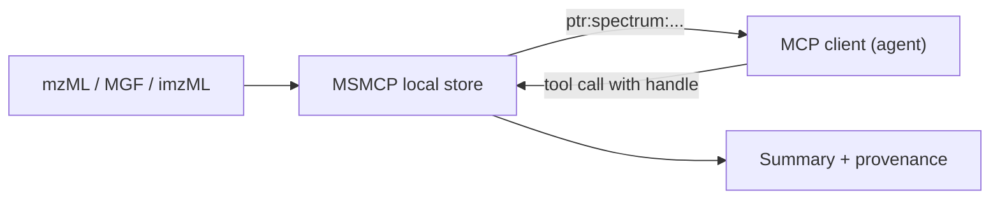

Agentic tools work best on analytical data when they **never inspect raw peak lists in the prompt** and **cannot launder a similarity score into a confirmed identification**.

The two open-source projects—[MassFlow](https://github.com/janusson/MassFlow) for local MS/MS library search and [MSMCP](https://github.com/janusson/MSMCP) for MCP-based tool access—follow that boundary independently. In MSMCP, spectral files stay on the server side while clients pass opaque handles:



## 1. Pass handles, not peak arrays

An untargeted LC-MS/MS acquisition contains large numbers of spectra and dense peak arrays. Sending raw `m/z` and intensity lists into a language model's context window wastes tokens, invites truncation, and encourages hallucinated assignments.

Instead, MSMCP parses spectra locally into a server-side reference store and returns a short opaque handle (`ptr:spectrum:…`). Downstream tool calls—QC summaries, adduct/isotope checks, spectral similarity, or library search—accept the handle and operate on the underlying arrays directly in Python.

## 2. Record what could not be calibrated

Every derived output travels with explicit provenance boundaries rather than prose caveats alone. When statistical error-rate calibration was withdrawn from MSMCP library search, provenance explicitly marked significance as uncalibrated (`significance_status="uncalibrated"`).

The following **illustrative example** (not a verbatim tool response) shows how candidate ranking is separated from identification confidence and uncalibrated significance:

```json
{
  "query_ref": "ptr:spectrum:<handle>",
  "candidates": [
    {
      "rank": 1,
      "similarity_metric": "cosine",
      "confirmed_identification": false
    }
  ],
  "provenance": {
    "significance_status": "uncalibrated",
    "note": "Illustrative schema only; library search carries no p-value, q-value, or FDR claim."
  }
}
```

Separating deterministic computation from model context—and recording scientific limits explicitly—keeps both human reviewers and automated workflows honest about what a measurement actually supports.
