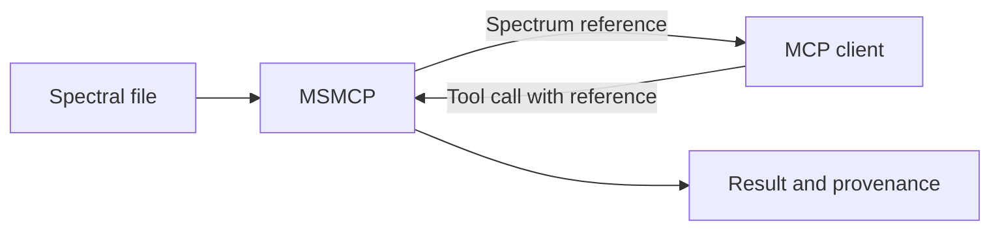

I built [MSMCP](https://msmcp.dev/) so a Model Context Protocol (MCP) client can ask a question
about a spectrum and get back a calculation performed on the actual data. An untargeted LC-MS/MS
file can contain thousands of spectra. Sending peak lists through a prompt makes it easy to lose
peaks to truncation and hard to tell exactly which data went into a calculation.

## How a client refers to a spectrum

MSMCP loads the spectrum locally and returns a reference such as `ptr:spectrum:…`. A client can pass
that reference to another tool to compare spectra, run a quality check, or search a library. The
tool reads the underlying arrays and runs the calculation in Python. The client gets the result
and its provenance.

## What a library search score tells you

A similarity score tells you how closely two spectra match under the chosen scoring method. I
withdrew MSMCP's search significance estimates because the calibration did not support the claims.
The search reports ranked candidates, and its provenance records
`significance_status="uncalibrated"`. That label means the search supplies no calibrated p-values,
q-values, or false discovery rate.

I maintain [MassFlow](https://github.com/janusson/MassFlow) separately for batch MS/MS library
searches. In either workflow, I use the rankings to decide which candidates to inspect. A strong
match can be useful evidence, but I still check the precursor, fragment assignments, and any
independent evidence available for the proposed compound.
